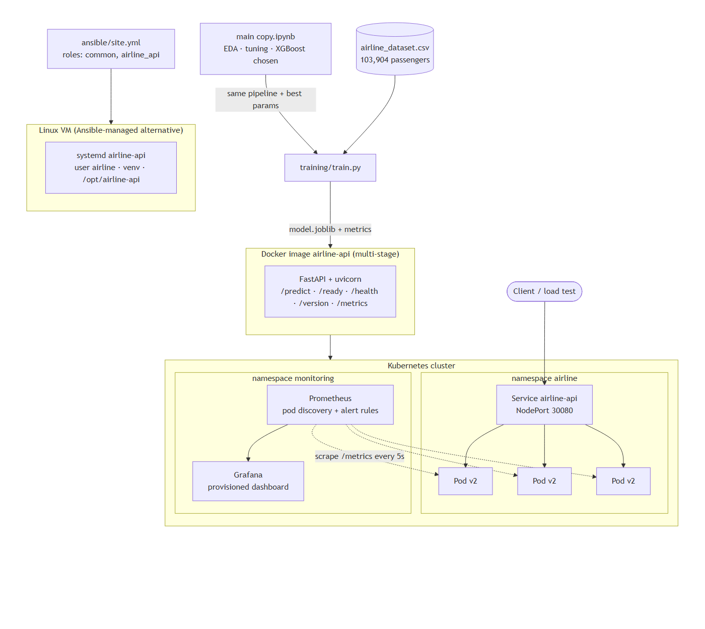

# Airline Passenger Satisfaction – DevOps CA2


The ML project in [`main copy.ipynb`](main%20copy.ipynb) predicts whether an airline passenger is
**satisfied** or **neutral/dissatisfied** (tuned XGBoost, **ROC-AUC 0.995**, accuracy 96.3 %).
This repo turns that notebook into a production-style service and runs it through a full DevOps tool-chain.

| Step | What | Where |
|---|---|---|
| 1. Deployment strategy | GitHub Actions pipeline: lint → train + quality gate → test → Docker build + smoke test → Ansible → Kubernetes rolling update/rollback → push to GHCR | [`.github/workflows/ci-cd.yml`](.github/workflows/ci-cd.yml), [pipeline diagram](docs/diagrams/pipeline.png) |
| 2. Configuration management | Ansible playbook: packages, service user, directories, virtualenv, model training, systemd unit | [`ansible/`](ansible/) |
| 3. Containers & orchestration | Multi-stage Dockerfile, K8s Deployment + Service, rolling update + rollback demo | [`Dockerfile`](Dockerfile), [`k8s/`](k8s/), [`scripts/k8s-rollout-demo.sh`](scripts/k8s-rollout-demo.sh) |
| 4. Monitoring & logging | Prometheus metrics + alert rules, Grafana dashboard (uptime, latency, error rate), JSON logs | [`monitoring/`](monitoring/), [screenshots](docs/screenshots/) |
| 5. Report & slides | Architecture, pipeline flow, challenges, lessons learned | [`docs/REPORT.md`](docs/REPORT.md) |
| 6. Bonus | Kaggle Playground S6E10 submission from the same notebook | [`docs/BONUS.md`](docs/BONUS.md) |



## Repository layout

```
app/                 FastAPI service (main.py), Prometheus metrics, shared feature list
training/train.py    Rebuilds the notebook's final model (same pipeline + tuned params) with a quality gate
tests/               API tests (pytest)
Dockerfile           Stage 1 trains the model, stage 2 is the slim non-root runtime image
docker-compose.yml   API + Prometheus + Grafana on one machine
k8s/                 Namespace, Deployment (3 replicas, RollingUpdate), Service, kind config
monitoring/          Prometheus config + alerts, Grafana provisioning + dashboard, K8s manifests
ansible/             Inventory, playbook, roles (common, airline_api)
scripts/             Rolling-update/rollback demo, load generator
docs/                Report, diagrams, screenshots, evidence logs
main copy.ipynb      Original analysis notebook (EDA, model comparison, tuning, interpretation)
```

## Quick start

**Run locally (Python 3.11+)**
```bash
pip install -r requirements-dev.txt
python training/train.py                 # ~5 s, writes models/model.joblib + metrics
pytest -v
uvicorn app.main:app --port 8000         # http://localhost:8000/docs
```

**Docker + monitoring**
```bash
docker compose up -d --build
python scripts/load_test.py --rps 10 --duration 300
# API http://localhost:8000/docs · Prometheus http://localhost:9090 · Grafana http://localhost:3000 (admin/admin)
```

**Kubernetes (kind) – rolling update and rollback**
```bash
kind create cluster --name airline --config k8s/kind-config.yaml
CLUSTER=kind ./scripts/k8s-rollout-demo.sh     # builds v1/v2, deploys, updates, breaks, rolls back
kubectl apply -k monitoring/                   # Prometheus :30090, Grafana :30300
```

**Ansible (from Linux/WSL/macOS)**
```bash
cd ansible
ansible-playbook -i inventory/hosts.ini site.yml    # edit the IP/user first
ansible-playbook -i inventory/local.ini site.yml    # or configure this machine
```

## API

| Method | Path | Purpose |
|---|---|---|
| GET | `/health` | Liveness – process is up |
| GET | `/ready` | Readiness – model loaded (503 if not) |
| GET | `/version` | App version, pod name, model metrics |
| POST | `/predict` | One passenger → `satisfied_probability`, `prediction` |
| POST | `/predict/batch` | Up to 1000 passengers |
| GET | `/metrics` | Prometheus metrics |

```bash
curl -X POST localhost:8000/predict -H 'Content-Type: application/json' -d '{
  "Gender":"Female","Customer Type":"Loyal Customer","Age":41,"Type of Travel":"Business travel",
  "Class":"Business","Flight Distance":2300,"Departure Delay in Minutes":0,
  "Inflight wifi service":5,"Online boarding":5,"Seat comfort":5}'
# {"satisfied_probability":0.9996,"prediction":"satisfied","model_version":"v1"}
```
Field names are the dataset's column names; any numeric field may be left out (imputed exactly as in the notebook).
