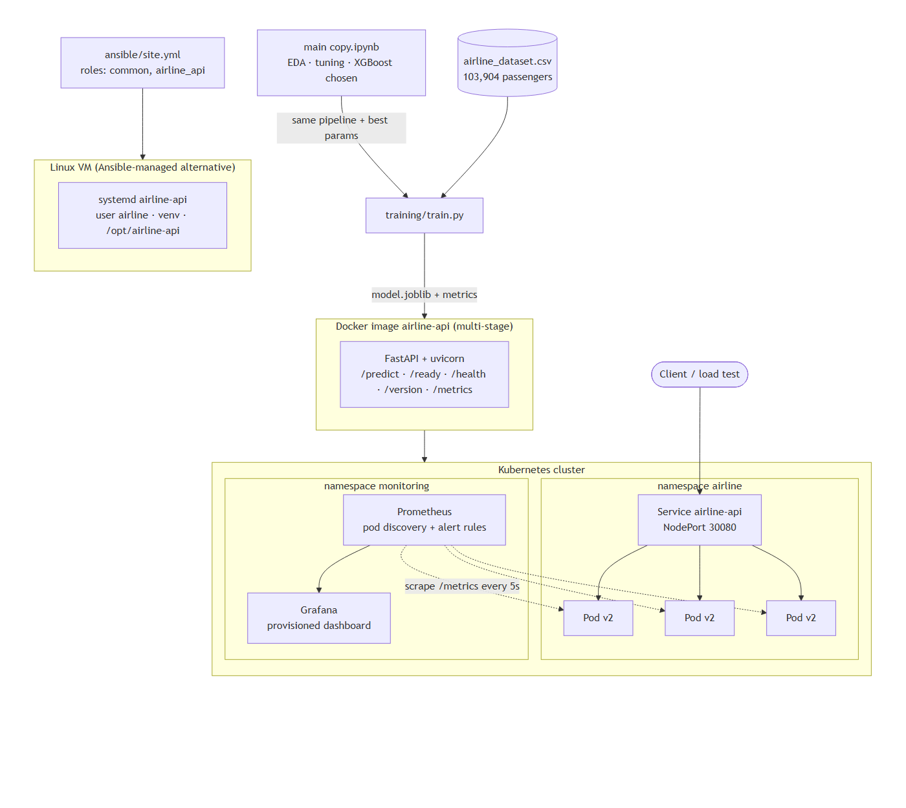
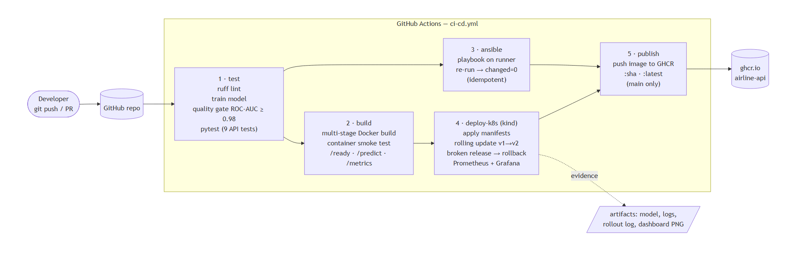
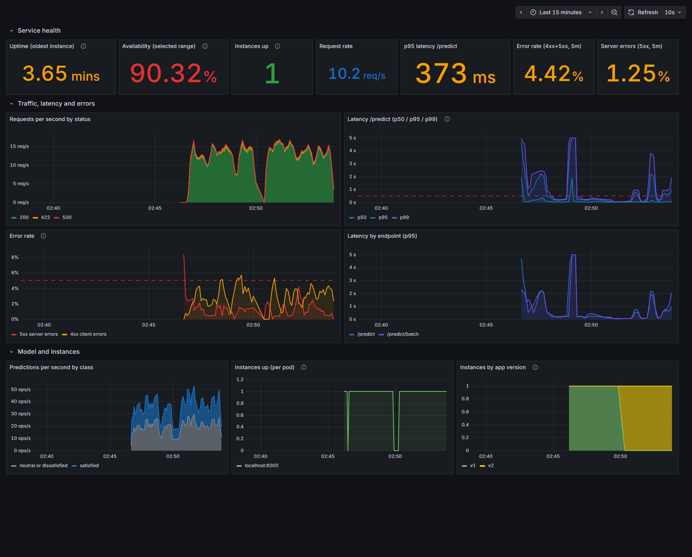
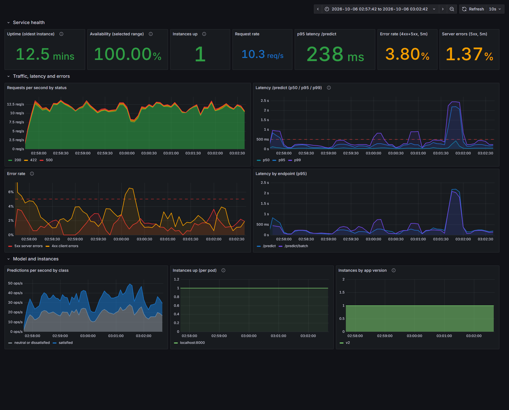
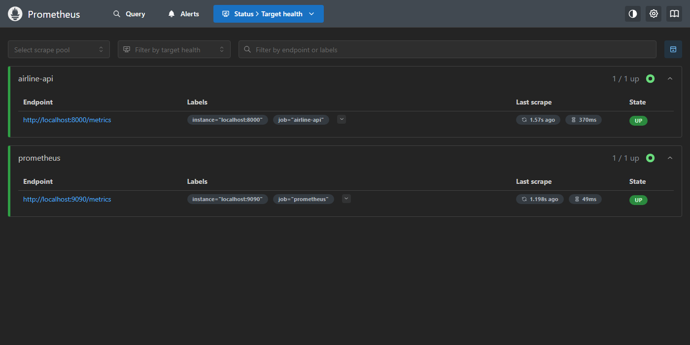

# DevOps CA2 – Project Report

**Project:** Airline Passenger Satisfaction prediction service
**Source project:** `main copy.ipynb` (EDA → leak-free preprocessing → Logistic Regression / Random Forest / XGBoost →
tuning → interpretation). Best model: tuned **XGBoost – accuracy 0.9627, F1 0.9567, ROC-AUC 0.9952** on a 20 % hold-out set.

---

## 1. Architecture

| Layer | Choice | Why |
|---|---|---|
| Model | `training/train.py` rebuilds the notebook's final pipeline (median/most-frequent imputation + missing flags, `log1p`, scaling, one-hot) with the tuned XGBoost parameters | One script reproduces the notebook's numbers exactly (0.9627 / 0.9567 / 0.9952) and can run in CI, Docker and Ansible |
| Service | FastAPI + uvicorn, Pydantic schema using the dataset's column names | Input validation (bad class / rating out of 0–5 → 422), automatic OpenAPI docs at `/docs` |
| Health | `/health` (liveness) and `/ready` (model loaded) are separate | A pod without a model stays alive for debugging but receives no traffic |
| Container | Multi-stage Dockerfile: stage 1 trains (with quality gate), stage 2 is a slim non-root runtime | The image is self-contained and the build fails if the model is worse than ROC-AUC 0.98 |
| Orchestration | Kubernetes Deployment (3 replicas, `RollingUpdate maxSurge=1 maxUnavailable=0`), NodePort Service | Zero-downtime updates; readiness probe gates traffic |
| Config management | Ansible roles `common` + `airline_api` → systemd service on a Linux VM | Same service can run without Kubernetes; playbook is idempotent |
| Monitoring | `prometheus_client` metrics → Prometheus (pod discovery + alert rules) → Grafana (provisioned dashboard) | Uptime, latency percentiles, error rate, predictions, versions |
| Logging | One JSON line per request (`ts, level, version, pod, method, path, status, duration_ms`) on stdout | Readable with `kubectl logs` / `journalctl` and ready for Loki or ELK |

### Metrics exposed by the API

| Metric | Type | Used for |
|---|---|---|
| `airline_api_http_requests_total{method,path,status}` | counter | request rate, error rate |
| `airline_api_http_request_duration_seconds{method,path}` | histogram | p50 / p95 / p99 latency |
| `airline_api_predictions_total{prediction}` | counter | class mix (drift signal) |
| `airline_api_start_time_seconds` | gauge | uptime |
| `airline_api_model_loaded` | gauge | readiness alert |
| `airline_api_app_info{version,model_roc_auc}` | gauge | which version each pod runs |

---

## 2. Pipeline flow (Step 1 – GitHub Actions)

| # | Job | What it does | Fails when |
|---|---|---|---|
| 1 | **test** | `ruff` lint → train model → **quality gate ROC-AUC ≥ 0.98** → 9 pytest API tests → metrics in job summary → model uploaded as artifact | lint error, model below gate, any test fails |
| 2 | **build** | Docker Buildx build (GHA layer cache) → run container → `/ready`, `/version`, `/predict`, `/metrics` smoke test → health status | image does not build or the container is not healthy |
| 3 | **ansible** | Runs `ansible/site.yml` against the runner itself → runs it **again and requires `changed=0`** → checks user, directories, systemd service, `/version` | playbook error or not idempotent |
| 4 | **deploy-k8s** | Creates a kind cluster → `scripts/k8s-rollout-demo.sh` (deploy v1, rolling update to v2, broken release, rollback) → deploys Prometheus + Grafana → load test + another rollout → Grafana screenshot | rollout fails, zero-downtime check fails |
| 5 | **publish** | Pushes `ghcr.io/<owner>/airline-api:<sha>` and `:latest` (only on `main`) | — |

Triggers: push / PR to `main`, plus manual `workflow_dispatch`. A newer push cancels the running pipeline for the same branch.

---

## 3. Configuration management (Step 2 – Ansible)

`ansible/site.yml` → roles:

- **common** – installs packages (`python3`, `python3-venv`, `libgomp1`, `curl`, `git`, `htop`, `acl`), creates the
  system group/user `airline` (uid 10001, no login shell), creates `/opt/airline-api/{app,models}`,
  `/var/log/airline-api`, `/etc/airline-api` with the right owners/modes, installs a templated `/etc/motd`.
- **airline_api** – copies code + dataset, builds a virtualenv from `requirements.txt`, trains the model only if it
  does not exist (`creates:`; retrains when the dataset changes), templates `/etc/airline-api/airline-api.env` and a
  hardened systemd unit (`NoNewPrivileges`, `ProtectSystem=strict`, …), enables the service, waits for `/ready`.
  Handlers restart the service only when something changed.

Inventories: `inventory/hosts.ini` (a remote Ubuntu VM over SSH) and `inventory/local.ini` (the current machine, used by CI).

---

## 4. Containerisation & orchestration (Step 3)

- `Dockerfile` – two stages; `APP_VERSION` build-arg is declared **last**, so `v1` and `v2` images share every
  cached layer and the version is visible in `/version` and the `airline_api_app_info` metric.
- `k8s/deployment.yaml` – 3 replicas, rolling update (`maxSurge 1`, `maxUnavailable 0`, `minReadySeconds 5`,
  `progressDeadlineSeconds 120`), readiness `/ready`, liveness `/health`, resource requests/limits, non-root,
  read-only root filesystem, Prometheus scrape annotations, `revisionHistoryLimit 10`.
- `k8s/service.yaml` – NodePort 30080.

`scripts/k8s-rollout-demo.sh` demonstrates:

1. **Deploy v1** and start a traffic pod calling the Service 4×/s, logging `version pod status`.
2. **Rolling update v1 → v2** (`kubectl set image`) – pods are replaced one at a time.
3. **Broken release** – `MODEL_PATH` points to a missing file. The new pod starts but never becomes Ready, so the
   rollout stalls and the three v2 pods keep serving (`maxUnavailable 0`).
4. **Rollback** – `kubectl rollout undo` (back to v2), then `kubectl rollout undo --to-revision=1` (back to v1).
5. Prints `kubectl rollout history` and counts **non-200 responses seen by the client (expected: 0)**.

Output goes to `docs/evidence/k8s-rollout-demo.log` and `docs/evidence/k8s-traffic.log` (also uploaded as the
`k8s-evidence` CI artifact).

---

## 5. Monitoring & logging (Step 4)

Prometheus scrapes every API pod every 5 s (static target in compose, `kubernetes_sd` pod discovery in K8s).
Alert rules: **AirlineApiDown**, **AirlineApiHighErrorRate** (> 5 % 5xx), **AirlineApiHighLatency** (p95 > 500 ms),
**AirlineApiModelNotLoaded**.

The Grafana dashboard *Airline Satisfaction API* is provisioned from `monitoring/grafana/dashboards/airline-api.json`:

| Row | Panels |
|---|---|
| Service health | Uptime, availability over the range, instances up, request rate, p95 latency, error rate (4xx+5xx), 5xx rate |
| Traffic, latency and errors | Requests/s by status, latency p50/p95/p99 (alert threshold line), error rate over time, p95 by endpoint |
| Model and instances | Predictions/s by class, `up` per pod, instances by app version (shows rollouts) |

*The demo run injected 1.5 % failures (`CHAOS_ERROR_RATE=0.015`) and 3 % invalid requests, so the error panels show data.
The dashboard covers v1 → v2. v1 had the latency problem described below; the scrape gaps around 02:47 and 02:50 are the
overloaded v1 process and its restart as v2.*

---

## 6. Challenges

| Challenge | What happened | Fix |
|---|---|---|
| **Latency under load** | The first load test (15 req/s) gave **p95 1.86 s** and client timeouts. The model was trained with `n_jobs=-1`, so each concurrent request started 8 OpenMP threads that fought for the CPU. | Set XGBoost to `n_jobs=1` at load time (scale with replicas instead). p95 fell to **74 ms (1-min window) / ~240 ms (5-min, steady state)** with no timeouts – visible on the dashboard as the v1 → v2 switch. The monitoring caught a problem the tests did not. |
| Remaining capacity limit | Profiling showed ~25 ms of pure-Python sklearn/pandas preprocessing per request. It holds the GIL, so one uvicorn worker tops out around 30 req/s and bursts queue (the p99 spikes on the steady-state dashboard). | Scale out, not up: the Deployment runs 3 replicas. Next steps would be an HPA on CPU, or exporting the pipeline to ONNX. |
| Load test on Windows | Requests to `http://localhost` sometimes took an extra 2 s because Windows tries IPv6 `::1` first and uvicorn listened on IPv4 only. | The load generator defaults to `127.0.0.1`. |
| Image size | The Linux `xgboost` wheel pulls in ~250 MB of CUDA/NCCL libraries. | Use `xgboost-cpu` (≈5 MB) on Linux via an environment marker in `requirements.txt`. |
| Rebuilding v2 was slow | `ARG APP_VERSION` at the top of the runtime stage invalidated the cache for `pip install`. | Moved the `ARG`/`ENV` to the end of the Dockerfile; v2 now rebuilds in seconds. |
| Tests re-registering metrics | Reloading the app module in tests raised "Duplicated timeseries in CollectorRegistry". | Metrics live in their own module (`app/metrics.py`) that is imported once. |
| Pod with no model | Crashing on a missing model makes debugging hard; ignoring it sends traffic to a broken pod. | Separate liveness (`/health`) and readiness (`/ready`); this is exactly what makes the "broken release" demo safe. |
| Windows development machine | Docker, kubectl and Ansible were not available locally. | The CI pipeline runs Ansible and a kind cluster on Linux runners and keeps the logs and screenshots as artifacts. The monitoring stack was run locally from the Windows Prometheus/Grafana builds. |
| Data leakage in the original notebook | An earlier version applied SMOTE before the train/test split. | `main copy.ipynb` splits first, keeps every fitted step inside a `Pipeline`, and uses class weights. The service reuses that pipeline, so production preprocessing matches training. |

## 7. Lessons learned

1. **Turn the notebook into one reproducible script early.** Once `train.py` reproduced the notebook's numbers exactly,
   CI, Docker and Ansible could all reuse it, and the quality gate became a single flag.
2. **A model metric is a deployment gate too.** Failing the build below ROC-AUC 0.98 treats model quality like a failing test.
3. **Readiness probes and `maxUnavailable: 0` are what make rolling updates safe.** The broken release never received traffic.
4. **Monitor before you need it.** The latency problem only showed up under concurrent load, on the dashboard.
5. **Label cardinality matters.** Metrics use the route template (`/predict`), never raw URLs or user input.
6. **Idempotency must be tested, not assumed.** CI runs the playbook twice and fails unless the second run reports `changed=0`.
7. **Cache-friendly Dockerfiles save minutes on every push.** Put things that change most (code, version) last.
