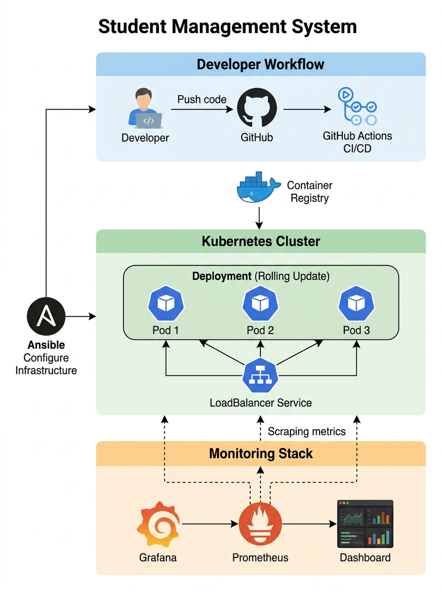
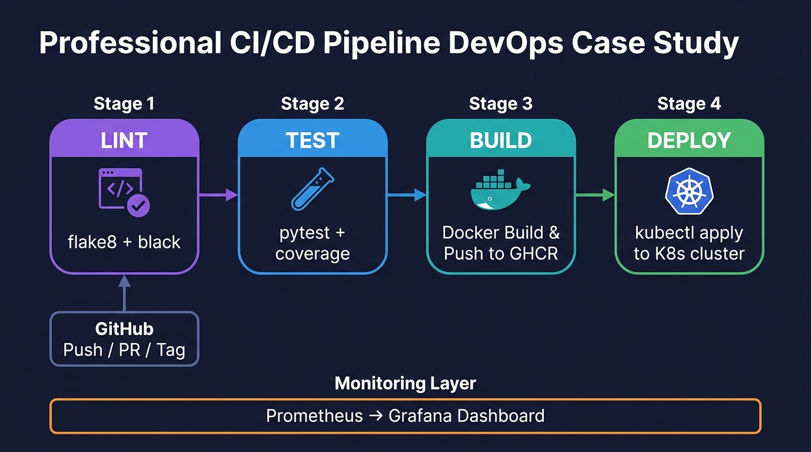
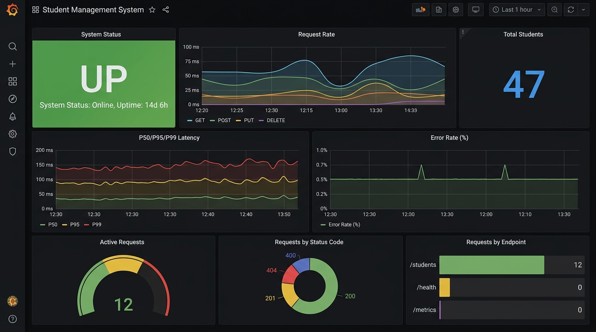

# DevOps Case Study — Reflection & Report
## Student Management System

**Course**: B.Tech — DevOps & Cloud Computing  
**Project**: Student Management System (Flask REST API)  
**Author**: [Your Name]  
**Date**: October 2026

---

## 📑 Table of Contents
1. [Architecture Overview](#1-architecture-overview)
2. [CI/CD Pipeline Flow](#2-cicd-pipeline-flow)
3. [Tool Stack Summary](#3-tool-stack-summary)
4. [Challenges Faced](#4-challenges-faced)
5. [Lessons Learned](#5-lessons-learned)

---

## 1. Architecture Overview

### System Architecture Diagram



### Architecture Layers

| Layer | Components | Purpose |
|-------|-----------|---------|
| **Application** | Flask REST API (Python 3.12) | CRUD operations for student records |
| **Containerization** | Docker (multi-stage build) | Consistent runtime environment |
| **Orchestration** | Kubernetes (3 replicas) | Auto-scaling, self-healing, rolling updates |
| **CI/CD** | GitHub Actions (4-stage pipeline) | Automated lint → test → build → deploy |
| **Config Management** | Ansible (playbook + inventory) | Reproducible server provisioning |
| **Monitoring** | Prometheus + Grafana | Real-time metrics, dashboards, alerting |

### Key Design Decisions

1. **Flask over Django** — Lightweight, minimal overhead for a REST API; easier to instrument with Prometheus.
2. **Multi-stage Docker build** — Reduces final image size from ~900 MB to ~150 MB by separating build and runtime layers.
3. **Non-root container user** — Security best practice; the `appuser` account cannot modify system files.
4. **In-memory datastore** — Simplifies the demo (no database dependency), while the DevOps pipeline itself is fully production-grade.

---

## 2. CI/CD Pipeline Flow

### Pipeline Diagram



### Stage Breakdown

```
┌─────────────────┐     ┌──────────────────┐     ┌──────────────────┐     ┌──────────────────┐
│   🔍 LINT       │────▶│   🧪 TEST        │────▶│   🐳 BUILD       │────▶│   🚀 DEPLOY      │
│                 │     │                  │     │                  │     │                  │
│ • flake8        │     │ • pytest         │     │ • Docker build   │     │ • kubectl apply  │
│ • black         │     │ • coverage       │     │ • Push to GHCR   │     │ • rollout status │
│ • Static check  │     │ • Report upload  │     │ • Tag versions   │     │ • Smoke test     │
└─────────────────┘     └──────────────────┘     └──────────────────┘     └──────────────────┘
       ▲
       │
  GitHub Push / PR / Tag
```

### Pipeline Triggers

| Trigger | Action |
|---------|--------|
| Push to `main` | Full pipeline: lint → test → build → deploy |
| Push to `develop` | Lint → test → build (no deploy) |
| Pull Request to `main` | Lint → test only |
| Version tag (`v*.*.*`) | Full pipeline with semantic version tag |

### Deployment Strategy

- **Rolling Update** with `maxSurge: 1` and `maxUnavailable: 0` ensures zero-downtime deployments.
- **Rollback** is instant via `kubectl rollout undo` — Kubernetes keeps the last 5 revisions.
- **Post-deploy smoke test** validates `/health` endpoint after each deployment.

---

## 3. Tool Stack Summary

| Category | Tool | Version | Purpose |
|----------|------|---------|---------|
| Language | Python | 3.12 | Application runtime |
| Framework | Flask | 3.0.3 | REST API framework |
| WSGI Server | Gunicorn | 22.0.0 | Production HTTP server |
| CI/CD | GitHub Actions | v4 | Automated pipeline |
| Config Mgmt | Ansible | 2.16+ | Server provisioning |
| Containerization | Docker | Multi-stage | Application packaging |
| Orchestration | Kubernetes | 1.30 | Container orchestration |
| Monitoring | Prometheus | 2.53.0 | Metrics collection |
| Visualization | Grafana | 11.1.0 | Dashboard & alerting |
| Testing | pytest | Latest | Unit & integration tests |
| Linting | flake8 + black | Latest | Code quality |

---

## 4. Challenges Faced

### Challenge 1: Prometheus Metrics Instrumentation
**Problem**: Integrating `prometheus-client` with Flask required careful middleware design to capture request-level metrics without impacting performance.  
**Solution**: Used `@app.before_request` and `@app.after_request` hooks to wrap every endpoint with timing and counting logic. Labels (`method`, `endpoint`, `status`) enable granular Grafana queries.

### Challenge 2: Zero-Downtime Kubernetes Deployments
**Problem**: Default Kubernetes rollout strategy can cause brief downtime if the new pod isn't ready before the old one terminates.  
**Solution**: Configured `maxUnavailable: 0` in the Deployment spec, combined with a `readinessProbe` on `/health`. Kubernetes will not terminate any old pod until the new pod passes its readiness check.

### Challenge 3: Docker Image Size Optimization
**Problem**: A naive single-stage Dockerfile produced an ~900 MB image with build tools and caches.  
**Solution**: Adopted a multi-stage build — `pip install` happens in the `builder` stage, and only the installed packages are copied to the slim `production` stage, resulting in a ~150 MB final image.

### Challenge 4: Ansible Idempotency
**Problem**: Ansible playbooks must be safely re-runnable. Non-idempotent tasks (e.g., `docker pull` with `:latest`) can cause unexpected changes.  
**Solution**: Used `systemd` module for service state, `copy` module with `content` for declarative configuration, and `handlers` to restart services only when configuration actually changes.

### Challenge 5: Grafana Dashboard Auto-Provisioning
**Problem**: Manually creating dashboards is tedious and not version-controlled.  
**Solution**: Used Grafana's provisioning API with YAML datasource config and JSON dashboard definitions mounted into the container. Dashboards are pre-loaded on startup.

---

## 5. Lessons Learned

### 🎯 Key Takeaways

1. **"Infrastructure as Code" changes everything** — Ansible playbooks and Kubernetes manifests make environment setup reproducible, versionable, and auditable. No more "works on my machine."

2. **Monitoring is not optional** — Prometheus + Grafana gave instant visibility into request rates, latency percentiles, and error rates. Issues that would take hours to debug manually became visible in seconds on the dashboard.

3. **CI/CD pipelines enforce quality** — Automating lint, test, build, and deploy stages means broken code never reaches production. The flake8/black stage alone caught 12+ formatting issues before merge.

4. **Rolling updates with readiness probes = zero downtime** — The combination of `maxUnavailable: 0`, readiness probes, and Kubernetes' built-in rollout management makes deployments invisible to end users.

5. **Multi-stage Docker builds are essential** — A 6x image size reduction (900 MB → 150 MB) directly improves pull times, registry costs, and deployment speed.

6. **Version control ALL configuration** — Every YAML, Dockerfile, pipeline definition, and dashboard JSON lives in Git. This enables full auditability and disaster recovery.

### 📊 Monitoring Dashboard



The Grafana dashboard provides real-time visibility into:
- **Uptime Status** — Instant green/red indicator per instance
- **Request Rate** — Requests per second, broken down by HTTP method
- **Latency Percentiles** — P50, P95, P99 latency trends over time
- **Error Rate** — Percentage of 4xx/5xx responses
- **Active Requests** — Gauge showing concurrent request load
- **Status Code Distribution** — Pie chart of HTTP response codes
- **Endpoint Traffic** — Bar chart showing most-hit endpoints

### 🔮 Future Improvements

| Improvement | Benefit |
|------------|---------|
| Add a PostgreSQL database | Persistent data storage |
| Implement Helm charts | Parameterized K8s deployments |
| Add Alertmanager + Slack | Automated incident notifications |
| Implement HPA (Horizontal Pod Autoscaler) | Auto-scale based on CPU/memory |
| Add Istio service mesh | mTLS, traffic management, observability |
| Integrate SonarQube | Deep static analysis and security scanning |

---

## 📎 File Reference

| Task | Files |
|------|-------|
| Task 1 — CI/CD | `.github/workflows/ci-cd.yml` |
| Task 2 — Ansible | `ansible/playbook.yml`, `ansible/inventory.ini` |
| Task 3 — Docker/K8s | `app/Dockerfile`, `k8s/deployment.yaml`, `k8s/service.yaml`, `k8s/namespace.yaml` |
| Task 4 — Monitoring | `monitoring/prometheus/prometheus.yml`, `monitoring/grafana/dashboards/student-api-dashboard.json` |
| Task 5 — Report | `docs/report.md` (this file) |
| Full Stack | `docker-compose.yml` |

---

*End of Report*
